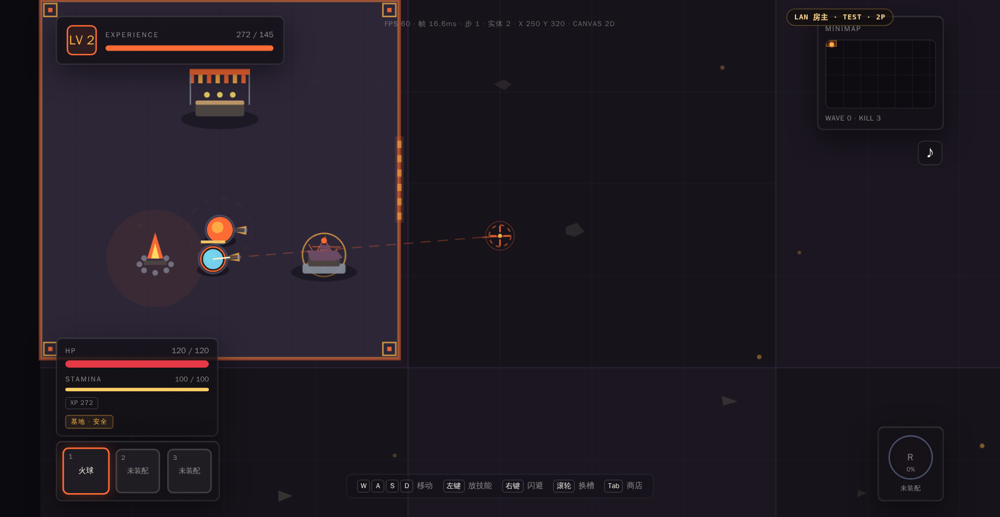
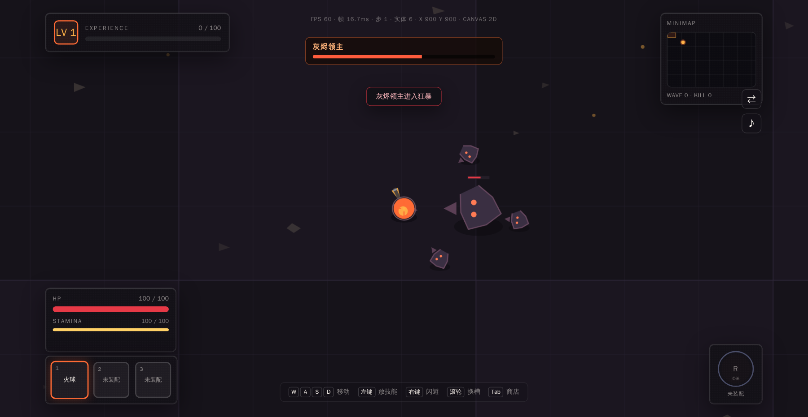

# Powerful Fire — v1.0（正式服务器 / 三生物群系 / 触控重写 / 四端应用）

> 2D 俯视角火系动作 RPG，TypeScript strict + Pixi.js v8 + Vite。
> M1–M8 已全部交付；v1.0 在 M8 基础上补齐 **正式服务端与部署、联机大厅多连接方式、三个生物群系、移动端触控重写、Windows/Linux/macOS/Android 应用包**。

## v1.0 新增

- **正式服务器**：`server/` 提供静态托管、`/health`、`/api/config`、`/api/rooms`、`/api/servers`、`/api/stats` 与 `/ws` 房间协议 v2；房间码 2–8 位、容量 1+3、64KB 限包、240 msg/s 限流、20s 心跳、房主断线 10s 宽限、客机 45s 重连令牌、空房 15min 回收。含 Dockerfile / compose / systemd / Nginx TLS 文档。
- **多连接方式**：HUD「⇄」联机大厅提供「本机 BroadcastChannel / 直连地址 / 服务器发现」三 Tab，可探测延迟、浏览公开房间、复用最近服务器、复制邀请链接；URL 参数 `net=host|join|client|server` 向后兼容。
- **三生物群系**：灰烬荒原（ember）、焦木林（grove，雾区减速 0.62）、熔岩裂谷（rift，岩浆圈 9 DPS）；区域标题、危害圈、群系色块、跨群系提示与对应敌人池（emberling / thornhusk / cinderling / magmaw / lavaback）。
- **触控重写**：左半屏浮动摇杆、右半屏拖动瞄准并开火、自动开火开关、大号闪避/大招、体力条、槽位按钮、震动反馈、竖屏提示；自动开火时 20° 锥形辅助瞄准最近敌人。
- **应用包**：Electron 桌面壳内置随机端口 HTTP 托管 `dist/`，产出 Windows x64、Linux x64、macOS x64/arm64 zip；Capacitor Android 工程产出 debug APK。

## 运行

```bash
cd powerful-fire
pnpm install
pnpm dev            # http://localhost:5173
pnpm build          # tsc --noEmit + vite build
pnpm preview        # 预览生产构建
pnpm server         # 正式服务器：静态托管 dist + 房间 API + WS（默认 8787）
pnpm test:server    # node --test 服务端房间测试
pnpm pack:desktop   # Windows/Linux/macOS zip → dist-app/
pnpm android:sync   # 同步 dist 到 Capacitor Android
pnpm android:apk    # Gradle assembleDebug → android/app/build/outputs/apk/debug/
```

联机：房主打开 `?net=host&room=ABCD&addr=http://<主机IP>:8787`，队友打开 `?net=join&room=ABCD&addr=http://<主机IP>:8787`；不填 `addr` 则走同浏览器 BroadcastChannel。也可点 HUD 右侧「⇄」，在「本机 / 直连 / 服务器」三个 Tab 中创建或加入房间。

触屏：浏览器打开 `?touch=1` 可强制启用虚拟摇杆（移动端 coarse pointer 会自动启用）。

### 打包环境

- 桌面：`pnpm build && pnpm pack:desktop`，产物在 `dist-app/`（Windows/Linux `.zip`，macOS `.app` 的 `.zip`）。macOS 包未做 Apple 公证，首次运行按 `desktop/README.txt` 处理隔离属性。
- Android：需要 **JDK 21**、Android SDK Platform 36、Build-Tools 36.0.0，设置 `ANDROID_HOME` 并在 `android/local.properties` 写 `sdk.dir`；`pnpm build && pnpm android:sync && pnpm android:apk`。
- 服务端：`pnpm server`；容器部署见 `docs/SERVER.md`。

## 操作

| 操作 | 键鼠 | 触屏 |
| --- | --- | --- |
| 移动 | WASD / 方向键 | 左下虚拟摇杆 |
| 瞄准 | 鼠标（60ms 延迟 + lerp 0.35 平滑） | 右半屏拖动 |
| 放技能 | 按住左键（按冷却节奏连发） | 右半屏按住即持续开火 |
| 闪避 | 右键（210px / 0.22s，0.3s 无敌，耗 25 体力） | 闪避按钮 |
| 冲刺 | 按住 Shift（+45% 移速，14 体力/秒） | —（键盘专属） |
| 换槽 | 滚轮 / 数字 1-3 | 底部三个槽位按钮 |
| 大招 | R（能量满时，耗 18 体力） | 大招按钮（显示充能百分比） |
| 商店 | Tab / 走到摊位按 F 或 E | 商店按钮 / 点击「打开技能商店」 |
| 升级台 | 走到铁砧按 F 或 E（Esc 关闭） | 点击「打开升级台」 |

## 本次新增

### 数据层（全部数值表驱动）

| 文件 | 内容 |
| --- | --- |
| `src/data/skills.json` | 24 个技能：法棍 4 / 热武器 5 / 火球 4 / 法术 7 / 大招 4，字段含冷却、前摇、伤害、行为与全部可选机制参数 |
| `src/data/enemies.json` | 焦炭行者：HP 46、速度 115、半径 17、接触伤害 12、前摇 0.45s、XP 12、击退抗性 0.3 |
| `src/data/config.json` | 新增 `player.dodge`、`ultimateChargePerDamage/Kill`、`spawner`、`economy`、`combat`（点燃/易燃/熔蚀/过热/超载）、`startLoadout` |

### 战斗（M2）

- `src/sim/runtime.ts` 定义 `Projectile / Area / XpOrb / DamageNumber / CastContext / Behavior`。
- `src/sim/systems/`：
  - `damage.ts` 收口所有伤害：熔蚀增伤、护盾吸收、超载 ×2、击退、点火/易燃/熔蚀施加、伤害数字、击杀掉落；
  - `projectiles.ts` 处理直飞、追踪、回旋、分裂、连锁与爆炸；
  - `areas.ts` 处理延迟判定（陨石/地刺）与持续伤害（火池/火墙/火雨），火墙带侧向击退；
  - `status.ts` 负责点燃 DoT、易燃/熔蚀衰减、玩家计时器与伤害数字生命周期；
  - `enemies.ts` 为 idle → chase → windup → recover 状态机 + 受击硬直 + 分离；
  - `spawner.ts` 环形刷怪、波次成长、远距离回收；
  - `pickups.ts` 光球吸附/拾取与升级循环。
- 对象池：`src/core/pool.ts`（投射物 400 / 区域 / 光球 / 伤害数字 40 上限）。

### 技能（24 个行为全部可释放）

`src/skills/registry.ts` 把 24 个 `behavior` 绑定到实现，`SKILL_DEF.fire(ctx)` 只读 `SkillData`：

- 法棍系：90° 扇形三段连击、回旋镖（去程/回程穿透）、黄油标记（易燃层数）。
- 热武器：火焰喷射（持续锥形 + 过热）、灼烧弹（抛射火池）、火箭（爆炸 + 击退）、钉枪（穿透）、过热机枪（转速越快冷却越短）。
- 火球：火球、连锁（命中后跳向下一个目标并衰减）、分裂（0.4s 后三向分裂）、鬼火（追踪）。
- 法术：火墙、陨石、新星、烈焰冲刺（瞬移 + 路径火池）、火焰护盾、地刺、凤凰之羽（被动复活）。
- 大招：焚天（跟随玩家的全屏火雨）、法棍审判（12 根依次砸落）、熔核超载（8s 零冷却 + 双倍伤害 + 结束虚弱）、凤凰涅槃（满血 + 全屏爆发 + 净化火）。

### M3 初步

- `src/sim/systems/casting.ts`：滚轮/数字切槽（120ms ease-out 过渡）、前摇计时、冷却校验、大招充能释放、过热锁定（100% 锁、降到 45% 解锁）、超载期零冷却。
- `src/ui/shop.ts`：24 张技能卡、系别筛选、价格排序、已购态、购买扣单一 XP、装备到槽 1/2/3 或大招位、提示条；打开即暂停逻辑。
- HUD：血条 + 护盾条、三槽冷却扇形遮罩、大招充能百分比与就绪高亮、状态芯片（过热/虚弱/护盾/XP）、WAVE / KILL 计数。

### 触屏

`src/ui/touch.ts`：左下摇杆（归一化八向）、右半屏拖动瞄准并持续开火、闪避/大招/商店按钮、槽位切换按钮；触屏模式下 HUD 自动上移避让。


### M4：安全基地

- `src/sim/base.ts`：基地为地图左上 `(0,0)-(500,500)` 安全区；`isInBase` / `clampOutsideBase`（按最近边把敌人推出，杜绝贴墙抖动）/ `facilityAt`（商店与升级台触发半径 78）。
- **仇恨清零**：`enemySystem` 检测玩家在基地内时，所有敌人立即 `state='idle'`、清空 `timer` 与速度；`spawner` 在基地内完全暂停刷怪，并拒绝在基地 90 单位外沿内生成；`damagePlayer` 再加一道「玩家在基地内直接返回」的绝对兜底。
- **基地恢复**：`playerSystem` 内 `base.healPerSecond = 5` 缓慢回血；体力在基地内按 `30/s` 回复（野外 `16/s`）。
- **设施**：技能商店复用 Tab 商店 UI；升级台为独立面板（`ui/camp.ts`），三类升级（体质强化 +12 MaxHP / 疾行训练 +4% 移速 / 烈焰淬炼 +6% 技能伤害）共享击杀 XP，费用按 1.35~1.45 成长，等级上限 8/6/6，写回 `world.progress.upgrades`。
- **场景绘制**：`render/base-view.ts` 纯 Graphics：石地网格 + 暖色边界 + 四角护符、红白条纹商店摊、铁砧与旋转符文、篝火（火焰摆动 / 辉光呼吸）、出口光门；新增 `layers.base`，渲染顺序 ground → base → groundFx → orbs → actors → projectiles → vfx。
- 小地图左上角新增 10%×10% 基地区块；HUD 增加「基地 · 安全」标识与设施交互提示。

### M4：体力系统

- `config.stamina`：上限 100、野外回复 16/s、基地 30/s、动作结束延迟 0.5s、闪避 25、冲刺 14/s、冲刺倍率 1.45、见底阈值 25；高阶技能按 `skills.json` 的 `stamina` 字段或 tier 兜底（power 12 / ultimate 18）。
- 技能在 `tryCast` / `tryUltimate` 起始扣体力并重置回复延迟；不足时提示「体力不足，XX释放失败」且**不进入冷却**。闪避不足只提示、不位移。
- HUD 左下 HP 条下方新增 5px 细体力条（黄色，低于 25% 转红并发光）+ 数值；`ui:notice` 事件经 `sendNotice` 1.4s 节流后显示顶部 toast。
- 死亡复活回基地并把体力补满；升级台购买的伤害加成写 `player.damageMult`，在 `applyDamage` 中与熔蚀 / 超载乘区相乘。


### M5：音频与 UI 动效

- `src/audio/synth.ts`：纯 WebAudio 合成，无采样资源；振荡器 + 滤波包络 + 低噪缓冲。
- `src/audio/audiobus.ts`：master / sfx / ui / music 四轨独立增益，`DynamicsCompressor`（threshold -8dB、ratio 12）兜底防破音；32 音上限，超出按权重淘汰最轻音；每个音效 ±5% 随机音高；音乐强度随 900 单位内敌人数平滑上升，基地内回落。
- `src/audio/sfx-map.ts`：17 类事件的双分层音色表（机械层 + 法术层），覆盖火球 / 法棍 / 喷火 / 火箭 / 法术 / 陨石 / 大招 / 命中 / 击杀 / 闪避 / 受伤 / 升级 / UI 点击 / 购买 / 升级台 / Boss 咆哮与倒地。
- `src/audio/audio-hooks.ts`：订阅 `skill:cast`、`player:dodge`、`player:hurt`、`enemy:kill`、`shop:purchase`、`base:upgrade` 等逻辑事件，位置只用于声像。
- UI：HUD 右上角新增音频按钮与四轨滑块 + 静音（打开面板不暂停）；等级横幅（ease-out-back 弹入）、受伤红色暗角（380ms 缓出）、提示 toast、面板开合均使用 `--ease-out-*` 令牌，全项目无 `linear` 缓动（仅 `linear-gradient` 背景纹理）。

### M6：存档与迁移

- `src/save/schema.ts`：`SaveData v3` 字段（seed / player level·xp·hp·maxHp·pos·deaths / unlockedSkills / loadout / world exploredChunks·defeatedBosses·bonfires / stats kills·playtime·deaths / progress 升级 / settings 四轨音量与静音）；`migrateSave` 把 v1 / v2 旧档逐字段补默认值升级到 v3，绝不直接丢弃。
- `src/save/idb.ts`：原生 IndexedDB（库 `powerful-fire`、store `saves`、key `slot0`），失败回退 localStorage；`pagehide` / 页面隐藏时同步写 localStorage 兜底。
- `src/save/manager.ts`：读档时比较 IndexedDB 与 localStorage 的 `savedAt` 取较新者；`apply` 回写等级/XP/HP/位置/解锁/装配/大招/升级/统计/世界进度（位置 clamp，失效技能 ID 自动剔除）；速度与伤害按升级等级重算，MaxHP 直接采用存档值避免重复叠加。
- 自动保存：60 秒游戏时间 + 关键节点（购买技能、升级台、升级）+ 卸载兜底；HUD 右上角 `SAVED` 指示 900ms；设置变更立即入档；`bootstrap` 用存档 seed 创建世界，镜头从存档位置开始。

### M7：局域网联机（2–4 人）

- `src/net/transport.ts`：`Transport` 抽象（`lan-host` / `lan-client` / `server` / `local`）。同浏览器用 `BroadcastChannel`；局域网用 `WebSocketTransport` 连 `server/index.mjs` 中继，房间码隔离，主机浏览器仍是唯一权威模拟端。
- `src/net/protocol.ts` / `snapshot.ts`：输入包（move / aim / fire / dodge / ult / sprint / slot，30Hz）+ 快照包（玩家、敌人、投射物、区域、光球，20Hz，只带渲染/HUD 字段）。
- `src/net/host.ts`：主机给每个队友创建远端 Player 实体（基地偏移出生），把网络输入写进 `world.remoteInputs`，20Hz 广播快照；200ms 无输入自动松开移动/开火，30s 无输入回收槽位。
- `src/net/client.ts`：客机不跑模拟，只发输入；本地玩家按输入做位置预测，收到快照后以 4×dt 收敛，误差 >140 单位才硬同步；HP / 体力 / 等级 / 槽位 / 冷却 / 大招充能全部以主机快照为准，伤害结算只在主机发生。
- `src/render/net-view.ts`：客机轻量渲染快照实体（玩家色环 + 朝向、敌人血条、投射物、区域、光球），100ms 双点插值；主机用同一视图只画队友（`playersOnly`），本地玩家仍走原 `WorldRenderer`。
- 多玩家模拟重构：`world.playerIds` + `remoteInputs`，`playerSystem` / `castingSystem` / `statusSystem` 按玩家循环；敌人选最近的非基地玩家索敌，`damagePlayer(..., targetId)` 定点结算；刷怪 / XP 光球改为服务全体玩家。
- 联机时商店 / 升级台不暂停世界；客机禁用本地存档写入。



### M8：Boss / 性能 / 平衡收尾

- Boss「灰烬领主」（`enemies.json` → `ashlord`）：HP 900 / 半径 40 / 震地 36 伤害 / 90% 击退抗性 / XP 220；血量 66% 与 33% 两阶段各召唤 4–5 只焦炭行者，攻击变为 190 半径范围震地；HUD 顶部 Boss 血条随阶段更新，击败写入 `progress.defeatedBosses`（存档保留）并触发 `boss:defeated` 音效与提示。
- 自动登场：波次每 6 波、玩家 ≥ LV3、场上无 Boss 且未击败过时，在玩家 360 距离外生成；`__PF__.debug.spawnBoss(x,y)` 可定点开战。
- 4 个大招全部可用：`ult_firesky`（跟随火雨）、`ult_baguette`（12 根法棍审判）、`ult_overload`（8s 零冷却）、`ult_rebirth`（满血复活）；均按 tier=ultimate 扣 18 体力、走能量条。
- 性能：对象池（投射物 400 / XP 光球 / 伤害数字 40 / 区域 96）；`GameLoop.currentStats` 新增 `tickMs` / `renderMs` 平滑值；`__PF__.debug.stress(120,400)` 一键压测。
- 平衡：Boss 伤害与召唤节奏按 1–2 人设计；玩家死亡保留 20% XP 惩罚 + 基地满血复活；基地内绝对安全、敌人丢失仇恨。



### 渲染

`src/render/enemy-view.ts`、`projectile-view.ts`、`area-view.ts`、`orb-view.ts`、`combat-views.ts`：
敌人角状几何体 + 受击白闪 + 头顶血条；投射物按种类预绘并复用一个 Graphics 池；区域按归一化图形缩放；XP 菱形光球；伤害数字走 DOM `#fx`（与 HUD 同一逻辑坐标系，避免 Canvas 文本开销）。

## 关键实现约束

- 逻辑层零 Pixi / 零 DOM：`sim/` 与 `skills/` 只依赖 `core/`、`data/`、`types`。
- 固定步长 60Hz；`Transform.prev*` 每步写入供 `alpha` 插值。
- 无 `setTimeout` 驱动玩法：技能多段（三段连击、12 根法棍）全部用 `world.timers.after`。
- 单文件 ≤ 300 行；色值集中在 `data/palette.ts`。
- 无 GPU 时自动进入 `perf-lite`（关闭面板背景模糊），有 GPU 时保留完整亚克力。

## 验证记录（本机实测，Chrome + Canvas 2D 软渲染）

| 项 | 结果 |
| --- | --- |
| 战斗闭环 | 生成 18 个敌人后按住左键：1.6s 内 14 杀、XP 掉落被吸附、升级到 LV2（HP 100→108，阈值 100→145） |
| 敌人 AI | 追击 → 0.45s 前摇 → 接触伤害；玩家 HP 100→88 掉血，受击数字弹出 |
| 闪避 | 右键后位移 207px（配置 210），期间无敌 |
| 死亡/复活 | HP 归零：死亡数 +1、XP 扣 20%（48→38）、回出生点满血、1.5s 无敌 |
| 凤凰之羽 | 装备后复活：HP 回到 40%（40/100）、羽毛进 59s 冷却、死亡数不变 |
| 大招 | 焚天生成跟随火雨；法棍审判 12 根柱子；超载进入 8s zero-cd（火球冷却 0.017s）；涅槃 12→100 满血 |
| 商店 | Tab 打开暂停；购买 100XP 技能后 XP 1900、解锁集合 +1；装配槽 2 后 HUD 与 `player.slots` 同步 |
| 滚轮换槽 | 滚轮一格 `activeSlot 0→1`，槽位高亮与技能名同步 |
| 冷却 | 火球释放后遮罩扇形覆盖，剩余时间显示 0.3s → 消失 |
| 触屏 | `?touch=1`：摇杆推动 1.4s 位移 336px；右侧拖动生成火球并进入冷却；槽位按钮切换生效；大招按钮显示 `大招 62%` |
| 基地回血 | HP 40 → 53（2.5s，实测 5.2/s）；体力 20 → 96（基地 30/s） |
| 仇恨清零 | 玩家在基地时，基地外与基地内生成的敌人全部 `idle`；基地内生成的敌人被推到 `x=517`（基地右沿 + 半径） |
| 基地安全 | 出基地被 2 只敌人围攻：HP 100→76；传送回基地后 1s 内 HP 76→81 且敌人 `state=idle`、速度 0 |
| 冲刺 | Shift+W 按住 1.2s：位移 302px（348 速度，撞世界边界），体力 100→83（14/s），松手 1s 回到 98 |
| 闪避体力 | 体力 100 → 右键 0.35s：位移 207px、体力 75；体力 0 时右键：toast「体力不足，无法闪避」、无位移 |
| 技能体力 | 陨石（10 体力）：40→32；体力 5 时释放：toast「体力不足，陨石术释放失败」且冷却不变 |
| 升级台 | XP 500 → 购买体质强化：MaxHP 124→136、XP -120；疾行 240→249.6、烈焰伤害 ×1.06；XP 不足时按钮禁用并提示「XP 不足」 |
| 暂停 | 升级台打开时 `world.elapsed` 冻结（89.5 保持不动），Esc / F 关闭恢复 |
| 交互 | 摊位旁 F 打开 Tab 商店、铁砧旁 F 打开升级台；提示条按位置切换文案 |
| 帧率 | 63 个敌人 + 基地场景：60fps（16.6ms/帧，逻辑步 1，CANVAS 2D） |
| 音频总线 | 首次点击后 AudioContext `running`（44.1kHz）；连播 80 次大招音，活动音源稳定在 32（上限）；Music 滑块 55%→30% 即时生效 |
| 等级/受伤表现 | `player:levelup` 触发「LEVEL n」横幅；出基地受击 HP 100→88 且暗角闪烁，class 自动回落 |
| 音频覆盖 | 火球/法棍/喷火/火箭/法术/陨石/大招/闪避/受伤/击杀/升级/购买/升级台均有独立双分层音色 |
| 存档恢复 | 买技能/升级/击杀/传送到 (820,760) 后刷新：LV4、XP 60/305、HP 92/136、位置、槽位（陨石+火球）、大招焚天、三项升级、KILL 21 全部恢复 |
| 存档迁移 | 写入 v1 档（seed 99 / LV2 / XP10 / KILL3）后刷新：自动升到 v3，等级/XP/击杀/位置保留，升级与设置补默认值，未丢档 |
| 设置持久化 | Music 70% → 刷新后滑块与 `audio.settings` 均为 70%，四轨音量与静音随存档保存 |
| 自动保存 | `save.update(61s)` 触发写盘，playtime 124→125、`savedAt` 更新；购买升级后立即落盘并显示 SAVED |
| LAN 双端 | 房主 + 客机（BroadcastChannel）：主机 `playerIds=2`，客机预测位置与主机远端实体同坐标；客机 HUD 等级/HP/槽位来自快照 |
| LAN 输入→快照 | WebSocket 中继 + 无头客机：远端玩家 240.5→712.5（2.6s，30Hz 输入），2.9s 收到 59 帧快照（≈20Hz） |
| LAN 伤害/技能 | 客机出基地后被焦炭行者攻击 HP 100→88；客机火球命中敌人，快照敌人 HP 46→0.2、投射物峰值 3；伤害只在主机结算 |
| Boss 阶段 | 灰烬领主 900 HP：降至 560 触发一阶段（召唤 4，场上 5）、降至 250 触发二阶段（再召唤 5，场上 12）；血条 62.2%→27.8% |
| Boss 击败 | 伤害管线击杀后 `enemies` 移除、`progress.defeatedBosses=['ashlord']`、Boss 血条隐藏、`boss:defeated` 事件触发 |
| 四大招 | 依次释放 `ult_firesky / ult_baguette / ult_overload / ult_rebirth`：区域数 1 / 6 / 6 / 5，均无控制台报错 |
| 性能上限 | 120 敌 + 400 投射物：tick 2.75ms、render 3.70ms、内存 30MB；120 敌 + 25 投射物：tick 0.42ms、render 2.42ms、60fps |
| 首包 | `dist` JS+CSS 合计 659KB（gzip 208KB），远低于 8MB |
| 兼容 | WebGPU 初始化失败仅告警并降级 Canvas 2D；`pnpm build`（tsc strict + vite）通过 |

调试句柄：`window.__PF__`（world / camera / loop / backend / renderer / layers / shop / camp / audio / save / net）与 `__PF__.debug`（spawnEnemy / spawnBoss / stress / addXp / giveUltimate / teleport / upgrade / setStamina）。

## 已知边界（下一里程碑）

- 技能协同的「易燃×火球系引燃爆炸」「同系 3 个专精」尚未接入（状态与标签字段已就绪）。
- 只有 1 种敌人（焦炭行者）；地图仍为单群系，区块加载与 5 群系顺延。
- 小地图只有玩家点与基地区块，没有敌人/群系信息。
- 联机仅房间码 + 中继地址手动加入，未做 mDNS 自动发现；断线 30s 内保留输入槽，重连需重新加入房间。
- 平衡数值为初版，等待手感调优。

## 目录

```
src/
  core/    loop ecs rng timer eventbus math pool
  data/    config(.json/.ts) skills(.json/.ts) enemies(.json/.ts) palette
  input/   keyboard mouse aim-resolver
  app/     hud-bridge debug pf-global.d.ts mounts audio-setup save-setup
  audio/   audiobus synth sfx-map audio-hooks heat
  save/    schema idb manager
  net/     protocol transport host client snapshot
  sim/     components runtime world spawn tick base upgrades
           systems/ aim input movement player casting enemies damage projectiles areas status spawner pickups notice
  skills/  registry helpers behaviors/(baguette heatgun projectile sorcery ultimate)
  render/  pixi-app viewport camera layers ground base-view player-view enemy-view projectile-view area-view orb-view combat-views crosshair aim-preview renderer
  ui/      hud shop camp touch audio-panel net-panel floating-text styles/acrylic.css
server/    index.mjs  # WebSocket 房间中继（主机权威）
```
